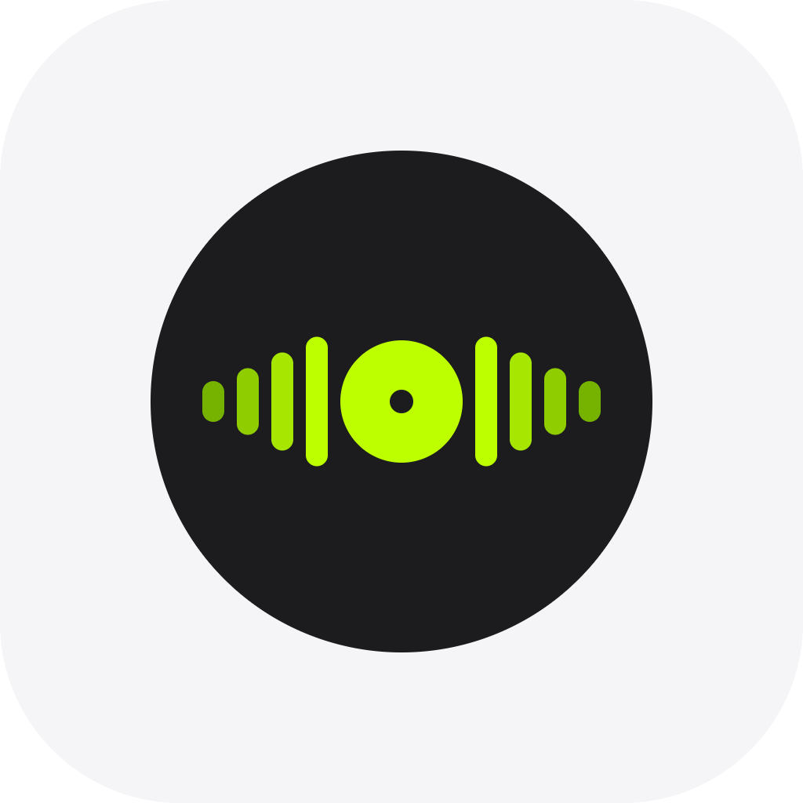

# HollowTone 空谷

> An elegant local music player that works on _almost_ every platform.

<p align="center">
  
</p>

HollowTone（空谷）是一个本地音乐播放器：不依赖任何中心服务，音乐放在你自己的电脑或 NAS 上，应用只负责扫描、整理和播放。使用 Flutter 编写，一套代码构建 Windows、Linux、macOS、Android 和 iOS。

---

## ✨ 特性

### 音乐库与播放

- 🎶 **本地播放** — 基于 media_kit（libmpv）的播放内核，后台播放与系统媒体控制由 audio_service 提供
- 📚 **目录扫描** — 手动扫描 + 监听音乐文件夹，文件变化自动入库
- 🏷️ **元数据解析** — 读取音频标签，补齐标题、艺术家、专辑与封面
- 💿 **专辑 / 艺术家浏览** — 按维度浏览并进入详情
- 📋 **播放列表** — 创建、排序、多选块移动
- 🔁 **播放队列** — 队列内多选块移动，播放模式一键切换
- ⏯️ **继续播放** — 记录上次播放位置

### 歌词

- 📝 **LRC 解析与逐行同步** — 支持内嵌歌词与外部 `.lrc` 文件
- 📐 **时间轴手动校准** — 整体偏移微调，单独调整歌词时序
- ☁️ **在线获取歌词** — 内置 Musixmatch / NetEase / Lrclib 三个来源，可只挑歌曲取词
- 🖼️ **在线匹配元数据** — 内置 NetEase / QQ Music 渠道，补全信息、下载封面、替换歌词
- 📥 **歌词与封面批量导入** — 与音频文件按文件名匹配

### 界面与平台

- 🎨 **主题** — 亮色 / 暗色 / 跟随系统，并从专辑封面提取自适应配色
- 🖥️ **桌面集成** — 系统托盘、关闭到托盘、桌面窗口控制
- 📡 **Jellyfin 远程库** — 通过应用内协议 URL 播放 Jellyfin 上的媒体
- 🌐 **多语言** — 简体中文 / English
- 📱 **多端** — Windows / Linux / macOS / Android / iOS

## 🖥️ 截图

*（待补充）*

## 🧱 技术栈

| 技术 | 用途 |
|------|------|
| [Flutter](https://flutter.dev/) | 跨平台 UI 框架 |
| [media_kit](https://github.com/media-kit/media-kit)（libmpv） | 音频播放 |
| [audio_service](https://pub.dev/packages/audio_service) | 后台播放与系统媒体控制 |
| [drift](https://drift.simonbinder.eu/) + SQLite | 本地音乐库存储 |
| [hooks_riverpod](https://riverpod.dev/) | 状态管理 |
| [go_router](https://pub.dev/packages/go_router) | 路由 |
| [easy_localization](https://pub.dev/packages/easy_localization) | 多语言 |
| [window_manager](https://pub.dev/packages/window_manager) / [tray_manager](https://pub.dev/packages/tray_manager) | 桌面窗口与系统托盘 |
| [jellyfin_dart](https://pub.dev/packages/jellyfin_dart) | Jellyfin 远程库 |
| [palette_generator](https://pub.dev/packages/palette_generator) | 封面配色提取 |

## 🚀 快速开始

需要 Flutter stable 渠道（本包要求 Dart SDK `^3.10.1`）。

```bash
flutter pub get

flutter run                 # 运行到当前平台
flutter run -d windows      # 指定平台
```

改动了 drift 表结构或带注解的 Riverpod provider 后，需要重新生成代码：

```bash
dart run build_runner build --delete-conflicting-outputs
```

## 📦 构建

```bash
# Windows —— 产物在 build/windows/x64/runner/Release/
flutter build windows --release

# Linux —— 产物在 build/linux/x64/release/bundle/
flutter build linux --release

# macOS
flutter build macos --release

# Android
flutter build apk --release

# iOS
flutter build ipa --release                  # 需要签名
flutter build ios --release --no-codesign    # 不签名
```

Linux 构建的系统依赖（与 CI 一致）：

```bash
sudo apt-get install -y clang cmake ninja-build pkg-config libgtk-3-dev liblzma-dev \
  libsecret-1-dev libasound2-dev libmpv-dev mpv libayatana-appindicator3-dev libmediainfo-dev
```

说明：

- Windows 安装包用 [Inno Setup](https://jrsoftware.org/isinfo.php) 编译仓库根目录的 `setup.iss`
- Android 构建时 CI 会就地修补已停止维护的 `flutter_media_metadata` 插件（`compileSdk` 提到 35，并捕获 `retriever.release()` 的 `IOException`），本地构建遇到同样的报错时需要照做
- `.github/workflows/build.yml` 是手动触发的构建工作流，可勾选 Windows / Linux / macOS / Android / iOS，并上传各平台产物

## 🗂️ 项目结构

```
lib/
├── data/         # drift 数据库与 repository
├── logic/        # 音频服务、歌词解析与获取、元数据、托盘与窗口
├── providers/    # Riverpod providers
├── ui/           # screens / tabs / widgets
├── main.dart
└── router.dart
assets/
├── images/       # 应用图标等
└── locales/      # zh.json / en.json
```

## 💾 数据与迁移

- 音乐库存储在 SQLite 中，数据库名为 `hollowtone_db`（drift_flutter 默认路径，位于应用文档目录）
- **从旧版本升级**：如果检测到更名前的 `groovybox_db.sqlite`，首次启动时会自动重命名为 `hollowtone_db.sqlite`，音乐库与播放列表不会丢失
- 远程流的内部协议已由 `groovybox://` 改为 `hollowtone://`，读取时仍兼容旧协议，历史条目无需重建

## 🔁 仓库更名说明

仓库已从 `luolingy/GroovyBox` 更名为 `luolingy/HollowTone`，GitHub 会保留旧地址的重定向。已有的工作区建议更新远端地址：

```bash
git remote set-url origin https://github.com/luolingy/HollowTone.git
```

## 👥 贡献者

- [luolingy](https://github.com/luolingy)
- [ZhiH](https://github.com/ZhiH2333)
- [符跃 万界](https://qm.qq.com/q/vMovFQlrj2)（图标设计）

原作者：[littlesheep2code](https://github.com/littlesheep2code)

## 📄 许可证

本仓库暂未包含 LICENSE 文件。

---

<p align="center">
  Made with ❤️ and Flutter
</p>
